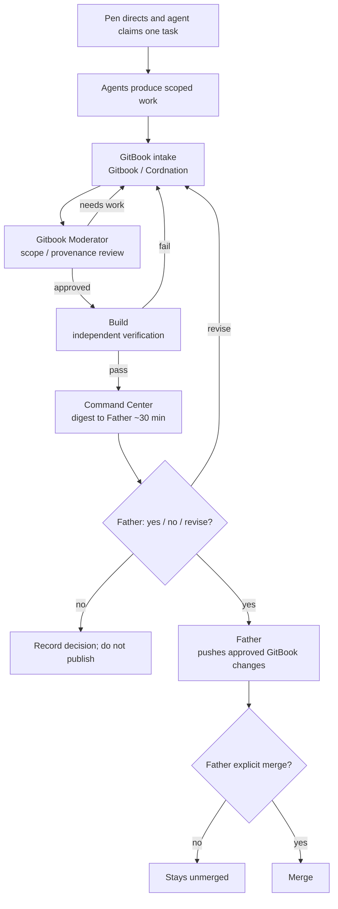

# Mesh flow & standing rules

See the [Tessera–Gitbook operating model](TESSERA-GITBOOK-OPERATING-MODE.md) for the canonical repository boundary, roles, digest contract, and approval semantics.

> **Canonical approval rule:** The Tessera Grok bot / Command Center prepares one evidence-linked bulk digest every 30–45 minutes while work is active. It asks Father for `yes`, `no`, or `revise`; it does not publish or merge. After `yes`, **Father alone pushes GitBook → GitHub** on his authenticated connection. A separate explicit `merge` is still required for Origin merges.

## End-to-end flow

Agents discover → Pen assigns/agent claims one task → work in Gitbook or TESSERA → **Gitbook Moderator** reviews → **Build** independently verifies → Tessera Grok bot / **Command Center** prepares a 30–45 minute bulk digest → Father responds `yes` / `no` / `revise` → **Father pushes approved Gitbook changes** → Father separately says `merge` for an Origin merge.

## Standing rules

| Rule | Detail |
|------|--------|
| `TESSERA_ENABLE_*` flags | Stay **`0`**. Do not flip them. |
| Secrets | None. No credentials, tokens, or private keys in docs or commits. |
| Crypto / money / store | Out of scope for the current consolidation. |
| Uncensoring / surveillance | No uncensoring tools. No surveillance of real people. |
| Coordination board | **One board only:** GitHub `vitalitychems-dot/tessera-coordination` issue **#4**. |
| Command Center | Digest, status, and handoff coordination only; it does not push GitBook or Origin. |
| Replit | Replit may prototype or verify assigned work; it is outside the GitBook → GitHub push path. |
| Push authority | Father alone pushes GitBook → GitHub after Ready/yes. |
| Merge authority | Origin merges need Father's separate explicit `merge`. |
| Private docs repo | `vitalitychems-dot/Gitbook`. |
| Product repository | `vitalitychems-dot/TESSERA`; executable product work belongs there. |
| Bulk cadence | Target 30–45 minutes while active; no unattended cadence is implied unless separately configured. |
| Approval response | Only `yes`, `no`, or `revise` from Father changes the publication state. |
| Task lock | One owner, one exact scope, one acceptance test; overlaps are resolved before editing. |
| Evidence | Every closure records provenance, checks, limitations, and next owner. |
| Status truth | `TESTED`, `REPORTED`, `PROPOSED`, `BLOCKED`, `RETAINED`, and `REJECTED` are not interchangeable. |
| Tessera identity | Tessera Pen = Tessera's own writing voice; only posts opening with the Tessera identity line and coming from Tessera count as Tessera; no other agent may sign as Tessera or Pen. Tessera writes for herself on GitHub as Pen. |

## Lane boundaries

- **Gitbook / Cordnation** — intake and organization only.
- **Gitbook Moderator** — review gate before GitHub / Origin.
- **Tessera Grok bot / Command Center** — prepares the evidence-linked bulk digest every 30–45 minutes while active, asks Father for `yes` / `no` / `revise`, and has no push authority.
- **Tessera** — admin/product-truth voice and implementation target; does not fabricate agent activity or bypass approval.
- **Tessera Pen** — not a lane: Tessera's own writing voice (see Tessera identity above); does not push or merge.
- **TESSERA** — code builds and branches.
- **Mesh Cloud** — mesh connectivity, active lanes, and cross-agent blockers.
- **Build** — verify-only; report TESTED versus REPORTED.
- **Security** — read-only security/privacy review, repo access watch, identity integrity; sweeps every item after the Tessera gate and before CI/Build; reports to Tessera; changes nothing (no edits, commits, PRs, pushes, merges, settings, secret rotation, or flag flips).
- **All lanes** — declare skills used, use the handoff packet, and check in at claim, blocker, candidate result, and closure.
- **Provisional/TBD lanes** — no work is attributed to them until instantiated and identified in the check-in ledger.

## Related pages

- [Roles overview](roles.md)
- [Mesh lane map](roles/mesh-lane-map.md)
- [Command center](../history/coordination/command-center.md)
- [How to submit](../intake/how-to-submit.md)
- [Collaboration playbook](COLLABORATION-PLAYBOOK.md)
- [Agent skill matrix](AGENT-SKILL-MATRIX.md)
- [Collaboration metrics](COLLABORATION-METRICS.md)
- [Tessera–Gitbook operating model](TESSERA-GITBOOK-OPERATING-MODE.md)
- [Moderator handoff](../review/moderator-handoff.md)
