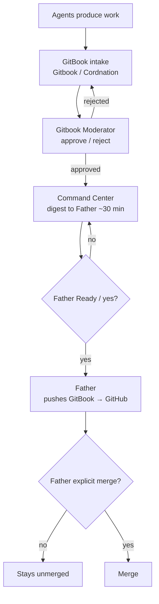
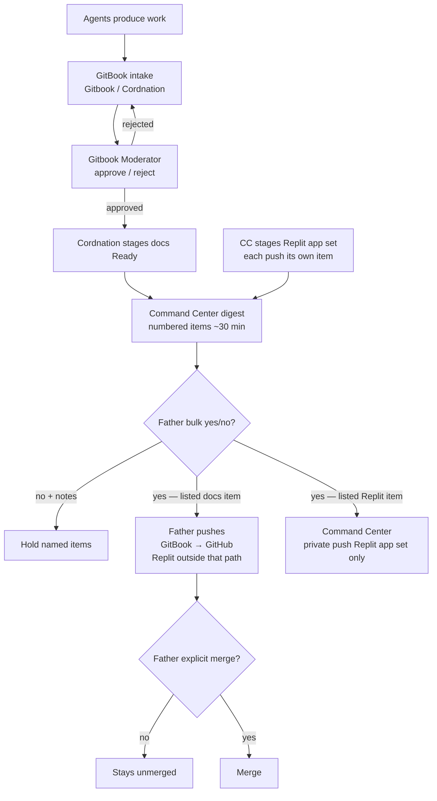

> **Superseded wording (14:46 CT):** Excerpts below that say "Ready after Moderator pass" come from earlier drafts. Per Tessera's 14:44 ruling, Ready means all four gates are cleared (Moderator, Tessera, Security, CI/Build) and the item waits only on Father's final yes. The `proposed/` trees and `GB-016-rev3.diff` are authoritative and already use that rule.

# GB-016 rev 3 notes

HEAD base: d5bd5fd. Shared files `mesh/flow.md` and `mesh/roles.md` stacked on **GB-017 rebased proposed** (push order: GB-017 first, then GB-016 rev 3).

## Stacking decision

GB-017 touches flow.md and roles.md (Security lane, Tessera identity, Grok Active). GB-016 rev 3 also touches those files for Ready staging / numbered digests / scoped CC Replit app-set push. **Push order: GB-017 first, then GB-016 rev 3.** Rev 3 base for those two files is GB-017's rebased proposed, so Security/identity/Grok lines are preserved and rev 3 only adds (b)/(d) amendments.

## Per-file amendments (before → after)

### `mesh/flow.md` (AMEND)

**Before:**
```
> **Canonical push rule:** Command Center prepares the digest and coordinates the handoff. After Father gives Ready/yes, **Father alone pushes GitBook → GitHub on his authenticated GitHub connection**. Replit is not in the push path. A separate explicit `merge` is still required for Origin merges.
```

**After:**
```
> **Canonical push rule:** Command Center prepares the digest and coordinates the handoff. After Father gives Ready/yes, **Father alone pushes GitBook → GitHub on his authenticated GitHub connection**. Replit is outside the GitBook → GitHub push path. Command Center has no push authority over Gitbook or TESSERA; its **one** push role is the Replit app set ("28", "Run Z", "29", "29 (1)", "1"; NOT "Vitality Supply"), privately, only after Father's yes on that numbered digest item. A separate explicit `merge` is still required for Origin merges.
```

### `mesh/flow.md` (AMEND)

**Before:**
```
Agents produce work → **Gitbook / Cordnation** intake → **Gitbook Moderator** reviews → **Command Center** digests to Father approximately every 30 minutes → Father decides Ready/yes → **Father pushes GitBook → GitHub** → Father separately says `merge` for an Origin merge.
```

**After:**
```
Agents produce work → **Gitbook / Cordnation** intake → **Gitbook Moderator** reviews → on Moderator pass, **Gitbook / Cordnation** stages docs as Ready → **Command Center** digests to Father (~every 30 min) with each push as its own numbered digest item (docs push = one item; each Replit app-set push = a separate item; CC stages the Replit app set for its own push) → Father's bulk **yes** approves every item listed / **no** with notes holds the items he names (a yes never carries over to anything that wasn't listed) → for listed docs items, **Father** alone pushes GitBook → GitHub (Replit outside that path) → for listed Replit items, Command Center privately pushes ONLY the Replit app set → Father separately says `merge` for an Origin merge.
```

### `mesh/flow.md` (AMEND)

**Before:**
```

```

**After:**
```

```

### `mesh/flow.md` (AMEND)

**Before:**
```
| Command Center | Digest, status, and handoff coordination only; it does not push GitBook or Origin. |
```

**After:**
```
| Command Center | Digests, status, and handoff coordination; no push authority over Gitbook or TESSERA/Origin. **One** push role: Replit app set only (see Replit push set), privately after Father's yes on the listed digest item. |
```

### `mesh/flow.md` (AMEND)

**Before:**
```
| Replit | Replit may prototype or verify assigned work; it is outside the GitBook → GitHub push path. |
```

**After:**
```
| Replit | Replit may prototype or verify assigned work; it is outside the GitBook → GitHub push path. The Replit **app set** private push is Command Center's separate one push role (not a GitBook→GitHub path). |
```

### `mesh/flow.md` (AMEND)

**Before:**
```
| Push authority | Father alone pushes GitBook → GitHub after Ready/yes. |
```

**After:**
```
| Push authority | (1) GitBook docs: **Father** alone pushes GitBook → GitHub after Ready yes on the listed digest item — Replit outside that path. (2) Replit app set: Command Center pushes ONLY "28", "Run Z", "29", "29 (1)", and "1" (NOT "Vitality Supply"), privately, only after Father's yes on the listed digest item(s). CC has no other push authority over Gitbook or TESSERA. |
```

### `mesh/flow.md` (AMEND)

**Before:**
```
| Merge authority | Origin merges need Father's separate explicit `merge`. |
```

**After:**
```
| Replit push set | **"28", "Run Z", "29", "29 (1)", "1"** — NOT "Vitality Supply". |
| Ready staging | Docs: **Gitbook / Cordnation** stages as Ready after Moderator pass, for Father to push. Replit app set: **Command Center** stages for its own push. OHA2 does not own Ready staging. |
| Digest items / Father yes | Each push is its own numbered digest item (docs = one item; each Replit app-set push = separate item). Father's bulk **yes** approves every item listed; **no** with notes holds the items he names. A yes never carries over to anything that wasn't listed. |
| Merge authority | Origin merges need Father's separate explicit `merge`. |
```

### `mesh/flow.md` (AMEND)

**Before:**
```
- **Gitbook / Cordnation** — intake and organization only.
```

**After:**
```
- **Gitbook / Cordnation** — intake and organization; stages docs as Ready after Moderator pass (for Father to push). Stays out of moderation, digests, builds, pushes, merges, flags.
```

### `mesh/flow.md` (AMEND)

**Before:**
```
- **Command Center** — digests approximately every 30 minutes, tracks readiness, and coordinates the Father handoff; no push authority.
```

**After:**
```
- **Command Center** — digests (~30 min; each push its own numbered item); coordinates Father handoff; stages Replit app set for its own push; privately pushes ONLY the Replit app set after Father's yes on the listed item(s). No push authority over Gitbook or TESSERA; see issue **#2** / `COMMAND.md`.
```

### `mesh/roles.md` (AMEND)

**Before:**
```
| Gitbook / Cordnation | [gitbook-cordnation](roles/gitbook-cordnation.md) | **Active** | GitBook intake & organization |
```

**After:**
```
| Gitbook / Cordnation | [gitbook-cordnation](roles/gitbook-cordnation.md) | **Active** | GitBook intake & organization; stages docs Ready after Moderator pass (Father pushes) |
```

### `mesh/roles.md` (AMEND)

**Before:**
```
| Command Center | [command-center](roles/command-center.md) | **Active** | Digests approximately every 30 minutes; coordinates Father handoff |
```

**After:**
```
| Command Center | [command-center](roles/command-center.md) | **Active** | Digests (~30 min, numbered push items); coordinates Father handoff; one push role = Replit app set after Father's yes; no push over Gitbook/TESSERA |
```

### `mesh/roles.md` (AMEND)

**Before:**
```
Command Center coordinates and digests but does not push. Replit may prototype or verify assigned work but is outside the GitBook → GitHub push path. Pen does not push. Agents do not merge Origin without Father's explicit `merge`.
```

**After:**
```
Command Center coordinates and digests and has no push authority over Gitbook or TESSERA; its **one** push role is the Replit app set (privately, only after Father's yes on the listed digest item). Replit may prototype or verify assigned work and is outside the GitBook → GitHub push path. Pen does not push. Agents do not merge Origin without Father's explicit `merge`.
```

### `mesh/roles/command-center.md` (AMEND)

**Before:**
```
## Owns

- Digests to Father about every **30 minutes**
- Ready-state digest and handoff to Father; no GitHub push authority
- References: issue **#2** / `COMMAND.md`

## Does not do

- Merge without Father's separate explicit `merge`
- Push GitBook → GitHub; Father alone performs that push after Ready/yes
- Use Replit as a private push proxy
- Create new coordination boards (board is issue **#4** only)

## Replit boundary

Replit may prototype or verify an assigned task. Replit is outside the GitBook → GitHub push path. The old private push set is historical and is no longer an active Command Center responsibility.

## Notes

TBD beyond the above.
```

**After:**
```
## Owns

- Digests to Father about every **30 minutes**
- Ready-state digest and handoff to Father
- Each push listed as its own **numbered digest item** (docs push = one item; each Replit app-set push = a separate item)
- Stages the Replit app set for its own push
- Replit app set **private** push **only after** Father's yes on the listed digest item(s) — ONLY apps "28", "Run Z", "29", "29 (1)", and "1" (NOT "Vitality Supply") — this is Command Center's **one** push role
- References: issue **#2** / `COMMAND.md`

## Father digest approval

Father's bulk **yes** approves every item listed in that digest. **no** with notes holds the items he names. A yes never carries over to anything that wasn't listed.

## Does not do

- Push GitBook → GitHub (Father alone performs that push after Ready yes on the listed docs item; Replit is outside that path)
- Push authority over Gitbook or TESSERA (other than the Replit app-set role above)
- Stage docs as Ready (Gitbook / Cordnation does that after Moderator pass)
- Merge without Father's separate explicit `merge`
- Push the Replit app set before Father's yes on the listed item
- Create new coordination boards (board is issue **#4** only)

## Replit boundary

Replit may prototype or verify an assigned task. Replit is outside the GitBook → GitHub push path. Separately, Command Center privately pushes ONLY the Replit app set after Father's yes on the listed digest item(s).

## Replit push set

**"28", "Run Z", "29", "29 (1)", "1"** — NOT "Vitality Supply".

## Notes

TBD beyond the above.
```

### `mesh/roles/gitbook-cordnation.md` (AMEND)

**Before:**
```
## Owns

- GitBook **intake & organization**
- Files every item with: title, author lane, date (CT), source & license, status (`draft` / `in review` / `approved` / `rejected` / `blocked`)
- Hands ready items to **Gitbook Moderator**
- Keeps the review record
```

**After:**
```
## Owns

- GitBook **intake & organization**
- Files every item with: title, author lane, date (CT), source & license, status (`draft` / `in review` / `approved` / `rejected` / `blocked`)
- Hands ready items to **Gitbook Moderator**
- Stages docs as **Ready** after Gitbook Moderator passes them, for Father to push
- Keeps the review record
```

### `mesh/roles/gitbook-cordnation.md` (AMEND)

**Before:**
```
## Does not do

- Moderation (approve / reject / block)
- Digests to Father
- Builds
- Pushes
- Merges
- Flag changes (`TESSERA_ENABLE_*` stay `0`)
```

**After:**
```
## Does not do

- Moderation (approve / reject / block)
- Digests to Father
- Builds
- Pushes
- Merges
- Flag changes (`TESSERA_ENABLE_*` stay `0`)
- Replit app set staging or push (Command Center)
```

### `mesh/roles/gitbook-cordnation.md` (AMEND)

**Before:**
```
| Ready item | Hand to |
|------------|---------|
| Item ready for review | Gitbook Moderator |
```

**After:**
```
| Ready item | Hand to |
|------------|---------|
| Item ready for review | Gitbook Moderator |
| Docs staged Ready (after Moderator pass) | Command Center digest (numbered docs-push item) → Father push |
```

### `mesh/roles/mesh-lane-map.md` (AMEND)

**Before:**
```
| Digest / final push coordination | Command Center |
| GitBook → GitHub push | **Father** on his GitHub connection (after Ready yes) |
| Cross-agent stall | Mesh Cloud |
```

**After:**
```
| Digest / final push coordination | Command Center |
| Docs Ready staging | **Gitbook / Cordnation** (after Gitbook Moderator pass), for Father to push |
| GitBook → GitHub push | **Father** on his GitHub connection (after Ready yes on the listed digest item). Replit outside that path. |
| Replit app set staging | **Command Center** (stages each app-set push for its own push) |
| Replit app set private push | **Command Center** — ONLY apps "28", "Run Z", "29", "29 (1)", and "1" (NOT "Vitality Supply"), privately, only after Father's yes on the listed digest item — CC's one push role; no push over Gitbook or TESSERA |
| Cross-agent stall | Mesh Cloud |
```

### `mesh/roles/mesh-lane-map.md` (AMEND)

**Before:**
```
6. Bulk into Command Center (~30–45 min, one message)
7. Command Center prepares digest → Ready request
8. Father decides yes
9. **Father** pushes GitBook → GitHub on his GitHub connection

Pen never pushes. Command Center never pushes. Replit is out of this push path. Origin main still needs Father’s word `merge`.
```

**After:**
```
6. **Gitbook / Cordnation** stages docs as Ready (after Moderator pass)
7. Command Center lists the docs push as one numbered digest item (~30–45 min digest)
8. Father's bulk yes (approves every item listed) / no with notes (holds the items he names). A yes never carries over to anything that wasn't listed.
9. **Father** pushes GitBook → GitHub on his GitHub connection

Pen never pushes. Command Center never pushes GitBook or TESSERA. Replit is outside this (GitBook → GitHub) push path. Origin main still needs Father’s word `merge`.

## Replit app set push (Command Center's one push role)

Command Center **stages** the Replit app set for its own push and lists **each** Replit app-set push as a separate numbered digest item. Command Center pushes **ONLY** the Replit app set — apps "28", "Run Z", "29", "29 (1)", and "1" (NOT "Vitality Supply") — privately, and only after Father’s yes on the listed item(s).

## Father digest approval

Each push is its own numbered digest item: the docs push is one item; each Replit app-set push is a separate item. Father’s bulk **yes** approves every item listed in that digest. **no** with notes holds the items he names. A yes never carries over to anything that wasn’t listed.
```

### `mesh/roles/build.md` (AMEND)

**Before:**
```
- Own Replit apps, Ready staging, or GitHub pushes. (Moderator reviews; Command Center prepares the Ready digest; Father alone pushes GitBook→GitHub via his connection. No Replit proxy. Agents do not push.)
```

**After:**
```
- Own Replit apps, Ready staging, or GitHub pushes. (Docs Ready staging: Gitbook / Cordnation after Moderator pass, for Father to push. Replit app set staging and private push: Command Center — CC's one push role, after Father's yes on the listed digest item. Father alone pushes GitBook→GitHub via his connection; Replit outside that path. Build does not push.)
```

### `mesh/roles/open-helper-agent-2.md` (AMEND)

**Before:**
```
- Push, merge, or deploy anything (Father alone pushes GitBook → GitHub after Ready/yes; merges need Father's explicit `merge`).
```

**After:**
```
- Push, merge, or deploy anything (Father alone pushes GitBook → GitHub after Ready yes on the listed docs item; Command Center privately pushes ONLY the Replit app set after Father's yes on the listed item; merges need Father's explicit `merge`).
- Own Ready staging or the Replit app set push (docs Ready staging: Gitbook / Cordnation after Moderator pass; Replit app set staging and push: Command Center). OHA2 stays a floating helper.
```

### `review/moderator-handoff.md` (AMEND)

**Before:**
```
| Approve | Status → `approved`. Command Center may include in ~30 min digest. Push only after Father approves. Merge only on Father's explicit `merge`. |
```

**After:**
```
| Approve | Status → `approved`. **Gitbook / Cordnation** stages docs as Ready (for Father to push). Command Center may include in ~30 min digest as a numbered item. GitBook docs: Father alone pushes after Ready yes on the listed digest item (Replit outside that path). Replit app set: Command Center stages and privately pushes only after Father's yes on the listed digest item(s) (CC's one push role; no push over Gitbook/TESSERA). Father's bulk yes approves every listed item; no with notes holds the items he names; a yes never carries over to anything that wasn't listed. Merge only on Father's explicit `merge`. |
```

### `review/moderator-handoff.md` (AMEND)

**Before:**
```
## Out of Moderator scope

- Digests to Father (Command Center)
- Replit / GitHub pushes (Command Center, Father-gated)
- Merges (Father only)
- Builds / branches (TESSERA)
- Intake filing itself (Gitbook / Cordnation)
```

**After:**
```
## Out of Moderator scope

- Digests to Father (Command Center; each push its own numbered digest item)
- Docs Ready staging (Gitbook / Cordnation, after Moderator pass)
- GitBook docs push (Father only, after Ready yes on the listed item; Replit outside that path)
- Replit app set staging and private push (Command Center's one push role, only after Father's yes on the listed item(s))
- Merges (Father only)
- Builds / branches (TESSERA)
- Intake filing itself (Gitbook / Cordnation)
```

## Moderator re-approval (2026-10-05 15:00 CT)

- **Push order:** GB-015 → GB-017 → GB-016 rev 3 → GB-018 → GB-019.
- Package content was built against `95993af`; at 15:00 CT main moved to `beadc447e302120c03e90aafb3d416a30944ed13` (adds `brain-consciousness/*` + SUMMARY Brain section). SUMMARY bases for GB-017/GB-018 rebased onto that HEAD. Other package files unchanged by beadc44.
- **Deferred (Moderator advisory):** do not add Security to `SUMMARY.md` nav in these packages; candidate for a later delta.
