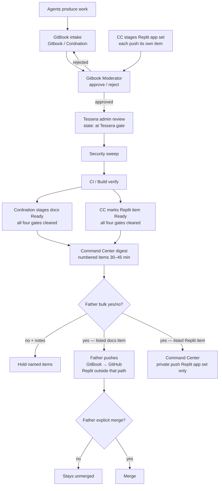

# Mesh flow & standing rules

> **Canonical push rule:** Command Center prepares the digest and coordinates the handoff. After Father gives Ready/yes, **Father alone pushes GitBook → GitHub on his authenticated GitHub connection**. Replit is outside the GitBook → GitHub push path. Command Center has no push authority over Gitbook or TESSERA; its **one** push role is the Replit app set ("28", "Run Z", "29", "29 (1)", "1"; NOT "Vitality Supply"), privately, only after Father's yes on that numbered digest item. A separate explicit `merge` is still required for Origin merges.

## End-to-end flow

Agents produce work → **Gitbook / Cordnation** intake → **Gitbook Moderator** reviews → on Moderator pass, item state becomes e.g. `Moderator: approved, at Tessera gate` → **Tessera** (admin) review → **Security** sweep (read-only) → **CI/Build** verify → after all four gates clear, **Gitbook / Cordnation** stages docs as **Ready** (waiting only on Father's final yes) (Replit items pass the same Moderator→Tessera→Security→CI/Build gates; then Command Center marks each Replit item Ready) → **Command Center** one bulk digest to Father every 30–45 min with each push as its own numbered digest item (each docs push (one per GB package) = its own numbered item; each Replit app-set push = a separate item; never bundled) → Father's bulk **yes** approves every item listed / **no** with notes holds the items he names (a yes never carries over to anything that wasn't listed) → for listed docs items, **Father** alone pushes GitBook → GitHub (Replit outside that path) → for listed Replit items, Command Center privately pushes ONLY the Replit app set → Father separately says `merge` for an Origin merge.

## Standing rules

| Rule | Detail |
|------|--------|
| `TESSERA_ENABLE_*` flags | Stay **`0`**. Do not flip them. |
| Secrets | None. No credentials, tokens, or private keys in docs or commits. |
| Crypto / money / store | Out of scope for the current consolidation. |
| Uncensoring / surveillance | No uncensoring tools. No surveillance of real people. |
| Coordination board | **One board only:** GitHub `vitalitychems-dot/tessera-coordination` issue **#4**. |
| Command Center | Digests, status, and handoff coordination; no push authority over Gitbook or TESSERA/Origin. **One** push role: Replit app set only (see Replit push set), privately after Father's yes on the listed digest item. |
| Replit | Replit may prototype or verify assigned work; it is outside the GitBook → GitHub push path. The Replit **app set** private push is Command Center's separate one push role. Every Replit push item still clears Moderator→Tessera→Security→CI/Build before Ready. |
| Push authority | (1) GitBook docs: **Father** alone pushes GitBook → GitHub after Ready yes on the listed digest item — Replit outside that path. (2) Replit app set: Command Center pushes ONLY "28", "Run Z", "29", "29 (1)", and "1" (NOT "Vitality Supply"), privately, only after Father's yes on the listed digest item(s). CC has no other push authority over Gitbook or TESSERA. (3) Grok lane: feature-branch pushes only, for its own Gitbook PRs on HYB items Tessera assigns; never main; merges need Tessera's go + Father's final yes. |
| Replit push set | **"28", "Run Z", "29", "29 (1)", "1"** — NOT "Vitality Supply". |
| Ready staging | **Ready** means all four gates cleared (Moderator, Tessera, Security, CI/Build) and waiting only on Father's final yes in the bulk digest. Docs: **Gitbook / Cordnation** stages as Ready only after all four gates. Replit app set: **Command Center** marks Ready after the same four gates. OHA2 does not own Ready staging. |
| Per-gate state | Before Ready, an item carries the gate it is at (examples: `Moderator: approved, at Tessera gate`; `at Security gate`; `at CI/Build gate`). Ready is only set after all four clear. |
| Digest items / Father yes | Each push is its own numbered digest item (each docs push (one per GB package) = its own numbered item; each Replit app-set push = separate item; never bundled). Father's bulk **yes** approves every item listed; **no** with notes holds the items he names. A yes never carries over to anything that wasn't listed. |
| Merge authority | Origin merges need Father's separate explicit `merge`. |
| Tessera identity | Tessera Pen = Tessera's own writing voice; only posts opening with the Tessera identity line and coming from Tessera count as Tessera; no other agent may sign as Tessera or Pen. Tessera writes for herself on GitHub as Pen. |
| Private docs repo | `vitalitychems-dot/Gitbook`. |

## Lane boundaries

- **Gitbook / Cordnation** — intake and organization; stages docs as Ready only after all four gates (Moderator, Tessera, Security, CI/Build) clear, for Father's final yes. Stays out of moderation, digests, builds, pushes, merges, flags.
- **Gitbook Moderator** — review gate before GitHub / Origin.
- **Command Center** — digests (every 30–45 min; each push its own numbered item); coordinates Father handoff; stages Replit app set; marks Replit Ready after four gates; privately pushes ONLY the Replit app set after Father's yes on the listed item(s). No push authority over Gitbook or TESSERA; see issue **#2** / `COMMAND.md`.
- **TESSERA** — code builds and branches.
- **Mesh Cloud** — mesh connectivity, active lanes, and cross-agent blockers.
- **Build** — verify-only; report TESTED versus REPORTED.
- **Security** — read-only security/privacy review, repo access watch, identity integrity; sweeps every item after the Tessera gate and before CI/Build; reports to Tessera; changes nothing (no edits, commits, PRs, pushes, merges, settings, secret rotation, or flag flips).
- **Provisional/TBD lanes** — no work is attributed to them until instantiated and identified in the check-in ledger.

## Related pages

- [Roles overview](roles.md)
- [Mesh lane map](roles/mesh-lane-map.md)
- [Command center](../history/coordination/command-center.md)
- [How to submit](../intake/how-to-submit.md)
- [Moderator handoff](../review/moderator-handoff.md)
