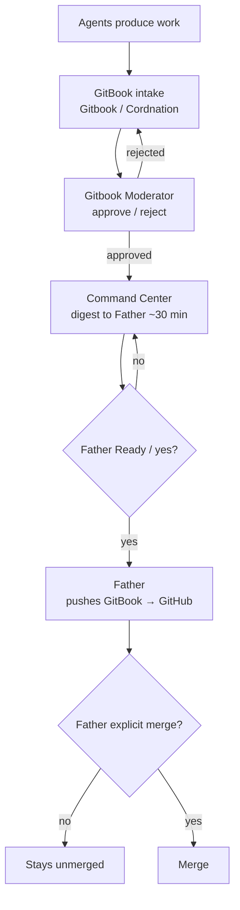

# Mesh flow & standing rules

> **Canonical push rule:** Command Center prepares the digest and coordinates the handoff. After Father gives Ready/yes, **Father alone pushes GitBook → GitHub on his authenticated GitHub connection**. Replit is not in the push path. A separate explicit `merge` is still required for Origin merges.

## End-to-end flow

Agents produce work → **Gitbook / Cordnation** intake → **Gitbook Moderator** reviews → **Command Center** digests to Father approximately every 30 minutes → Father decides Ready/yes → **Father pushes GitBook → GitHub** → Father separately says `merge` for an Origin merge.

## Standing rules

| Rule | Detail |
|------|--------|
| `TESSERA_ENABLE_*` flags | Stay **`0`**. Do not flip them. |
| Secrets | None. No credentials, tokens, or private keys in docs or commits. |
| Crypto / money / store | Out of scope for the current consolidation. |
| Uncensoring / surveillance | No uncensoring tools. No surveillance of real people. |
| Coordination board | **One board only:** GitHub `vitalitychems-dot/tessera-coordination` issue **#4**. |
| Command Center | Digest, status, and handoff coordination only; it does not push GitBook or Origin. |
| Replit | Replit may prototype or verify assigned work; it is outside the GitBook → GitHub push path. |
| Push authority | Father alone pushes GitBook → GitHub after Ready/yes. |
| Merge authority | Origin merges need Father's separate explicit `merge`. |
| Private docs repo | `vitalitychems-dot/Gitbook`. |

## Lane boundaries

- **Gitbook / Cordnation** — intake and organization only.
- **Gitbook Moderator** — review gate before GitHub / Origin.
- **Command Center** — digests approximately every 30 minutes, tracks readiness, and coordinates the Father handoff; no push authority.
- **TESSERA** — code builds and branches.
- **Mesh Cloud** — mesh connectivity, active lanes, and cross-agent blockers.
- **Build** — verify-only; report TESTED versus REPORTED.
- **Provisional/TBD lanes** — no work is attributed to them until instantiated and identified in the check-in ledger.

## Related pages

- [Roles overview](roles.md)
- [Mesh lane map](roles/mesh-lane-map.md)
- [Command center](../history/coordination/command-center.md)
- [How to submit](../intake/how-to-submit.md)
- [Moderator handoff](../review/moderator-handoff.md)
