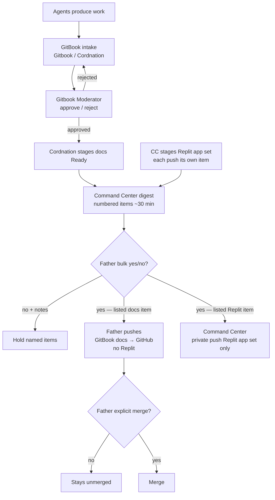

# Mesh flow & standing rules

> **Status: approved by Gitbook Moderator (2026-10-05) as GB-017. Awaiting Father push (after GB-016).**

## End-to-end flow

Agents produce work → **GitBook** (intake by Gitbook/ Cordnation) → **Gitbook Moderator** reviews → on Moderator pass, **Gitbook / Cordnation** stages docs as Ready → **Command Center** digests to Father (~every 30 min) with each push as its own numbered digest item (docs push = one item; each Replit app-set push = a separate item; CC stages the Replit app set for its own push) → Father's bulk **yes** approves every item listed / **no** with notes holds the items he names (a yes never carries over to anything that wasn't listed) → for listed docs items, **Father** pushes GitBook docs to GitHub himself (no Replit) → for listed Replit items, Command Center privately pushes ONLY the Replit app set → merges require Father's separate explicit `merge`.

## Standing rules

| Rule | Detail |
|------|--------|
| `TESSERA_ENABLE_*` flags | Stay **`0`**. Do not flip them. |
| Secrets | None. No credentials, tokens, or private keys in docs or commits. |
| Crypto / money / store | Out of scope. No crypto, money, or store work. |
| Uncensoring / surveillance | No uncensoring tools. No surveillance of real people. |
| Coordination board | **One board only:** GitHub `vitalitychems-dot/tessera-coordination` issue **#4**. Do not create new boards. |
| Replit push set | **"28", "Run Z", "29", "29 (1)", "1"** — NOT "Vitality Supply". |
| Origin | `collin-keane/Tessera` (Cursor engine). |
| Private docs repo | `vitalitychems-dot/Gitbook`. |
| Ready staging | Docs: **Gitbook / Cordnation** stages as Ready after Moderator pass, for Father to push. Replit app set: **Command Center** stages for its own push. OHA2 does not own Ready staging. |
| Digest items / Father yes | Each push is its own numbered digest item (docs = one item; each Replit app-set push = separate item). Father's bulk **yes** approves every item listed; **no** with notes holds the items he names. A yes never carries over to anything that wasn't listed. |
| Push authority | Both paths canon, split by type. (1) GitBook docs: **Father** pushes to GitHub himself after Ready yes on the listed digest item — no Replit. (2) Replit app set: Command Center pushes ONLY "28", "Run Z", "29", "29 (1)", and "1" (NOT "Vitality Supply"), privately, only after Father's yes on the listed digest item(s). |
| Merge authority | Merges need Father's **separate** explicit `merge`. |
| Tessera identity | Only messages that come from Tessera's own chat count as Tessera. Tessera writes for herself on GitHub as Pen. |

## Lane boundaries (high level)

- **Gitbook / Cordnation** — intake & organization; stages docs as Ready after Moderator pass (for Father to push). Stays out of moderation, digests, builds, pushes, merges, flags.
- **Gitbook Moderator** — review gate before anything reaches GitHub / Origin.
- **Command Center** — digests (each push its own numbered item); stages Replit app set for its own push; private push of Replit app set only after Father's yes on the listed item(s) (does not push GitBook docs); see issue **#2** / `COMMAND.md`.
- **TESSERA** — build lane (code builds and branches).
- **Mesh Cloud** — mesh connectivity; tracks active agents/lanes and cross-agent blockers.
- **Security** — read-only security review, repo access watch, identity integrity; reports to Tessera; fixes go through Tessera to Father's digest. No pushes, merges, settings changes, secret rotation, or flag flips.
- Other lanes — see [Roles overview](roles.md); provisional and TBD roles are marked as such.

## Related pages

- [Roles overview](roles.md)
- [How to submit](../intake/how-to-submit.md)
- [Moderator handoff](../review/moderator-handoff.md)
