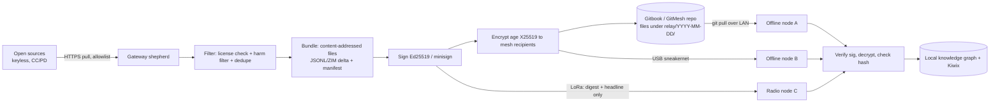

# SHEPHERD-RELAY: design only (nothing built, nothing pushed)

As of 2026-10-12 CT. This is how offline TESSERA nodes get **fresh open data** without each node having an IP route to the regular web.

## Roles
- **Gateway shepherd:** an agent on a mesh node that has internet. It only pulls **keyless, openly licensed** sources (RSS/Atom, Wikimedia dumps & EventStreams, arXiv OAI-PMH, MedlinePlus XML, PMC OA, NOAA/weather open feeds, OpenStreetMap diffs, GitHub public releases).
- **Courier:** any device that carries bundles: LAN peer, USB stick, or a LoRa/Meshtastic radio (LoRa carries only tiny signed digests/headlines, under 200 B per packet).
- **Offline node:** verifies, decrypts, and imports into local knowledge graph + Kiwix library.

## Flow

## Rules
1. **Keyless only.** No accounts, no logins, no scraping behind auth, no captcha or bot-detection bypass. Respect robots.txt and rate limits.
2. **License gate.** Pass only CC0, CC BY, CC BY-SA, public-domain, or ODbL items, and attach attribution to the manifest. Anything else gets dropped.
3. **Harm restrictions only.** The filter blocks malware, weapons-uplift content, personal data and people-OSINT, and wallet/crypto/trading payloads. It does not filter on viewpoint.
4. **Crypto:**
   - Signing uses Ed25519 with a per-shepherd key. Public keys are pinned in `mesh/keys/`.
   - Bundles are encrypted with age (X25519) to the node recipients list.
   - Integrity uses SHA-256 content addressing.
   - Private keys are never committed. They live in the node keystore.
5. **Publishing to Gitbook/GitMesh:**
   - Add only encrypted bundles and signed manifests (git-crypt-compatible paths).
   - Never rewrite history. Use append-only `relay/` folders.
   - Retention prunes old bundles via a normal delete commit, and only after Father's approval.
6. **Freshness:**
   - Each manifest carries `fetched_at`, `source_url` and `license`.
   - Offline nodes show data age.
   - LoRa digests let a node know new data exists before the bundle arrives.
7. **Toggles:**
   - Shepherd relay obeys the owner mesh toggle and "let agents manage".
   - It switches on only while a node is online, items are queued, and nodes have requested topics.
8. **Honesty:** truly live data still needs at least one gateway. The mesh moves the data. It does not create internet access.

## Modules (proposed)
- `mesh/shepherd/pull.ts` (allowlist fetchers)
- `mesh/shepherd/filter.ts` (license + harm)
- `mesh/shepherd/bundle.ts` (sign + encrypt)
- `mesh/courier/{lan,usb,lora}.ts`
- `mesh/import.ts` (verify → graph)

Tests use fixture feeds only. No network in CI.

## Per-source throttle (approved by Father, 2026-10-12)
- **Token bucket per source:** the rate is set to about 80% of the source's published limit (e.g., Wikimedia API ≤ 200 req/s documented, so we use a much lower budget of ~5 req/s per shepherd; arXiv OAI-PMH 1 req / 3 s, so we use 1 req / 4 s; NCBI E-utilities 3 req/s without a key, so we use 2 req/s). The burst size is small (≤ 5). Limits live in `mesh/shepherd/sources.yaml`, each with a URL citing the published policy.
- **Adaptive backoff:**
  - On **429/503**, honor `Retry-After` exactly. If it's absent, use exponential backoff (base 2 s, ×2, cap 1 h, ±20% jitter) and halve the bucket rate. The rate recovers gradually (+10% per clean hour).
  - After 3 consecutive 429s, the source is paused for 24 h and flagged in the shepherd log.
- **Priority scheduling across the day:**
  - P0 (safety/weather/health alerts) runs any time within budget.
  - P1 (requested topics) runs in normal hours.
  - P2 (bulk dumps/ZIM deltas) runs only in the source's off-peak window (e.g., 01:00–06:00 source-local) and when no P0/P1 work is queued.
- **Request coalescing:** identical or overlapping requests from many offline nodes are merged into one fetch per source per interval. The result is fanned out in one bundle.
- **Caching:** store `ETag` / `Last-Modified` and send `If-None-Match` / `If-Modified-Since`. A 304 costs no bundle space. Prefer the source's dumps or feeds over per-item API calls.
- **Identity:** use an honest `User-Agent: TESSERA-Shepherd/1.0 (+contact URL)` and respect robots.txt.
- **Forbidden:** no rotating proxies, no IP/identity rotation, no evading limits, and no parallel shepherds splitting one source's budget to exceed it. The budget is global per source across the mesh, coordinated through the GitMesh lease file `relay/leases/<source>.json`.
