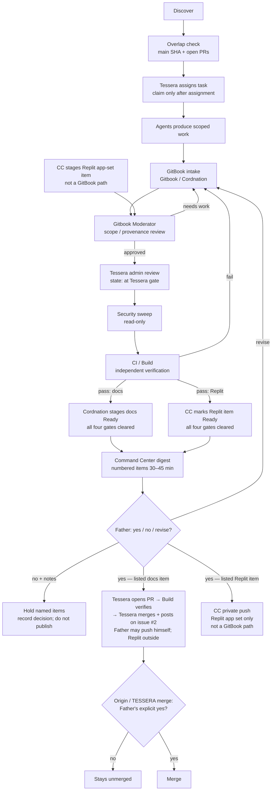

# Mesh flow & standing rules

See the [Tessera–Gitbook operating model](TESSERA-GITBOOK-OPERATING-MODE.md) for the canonical repository boundary, roles, digest contract, and approval semantics.

> **Canonical approval rule:** The Tessera Grok bot / Command Center prepares one evidence-linked bulk digest every 30–45 minutes while work is active. It asks Father for `yes`, `no`, or `revise`; it does not publish or merge. After `yes`, **Tessera pushes the approved GitBook packages**: she opens a PR, Build verifies it, then Tessera merges and posts on [Gitbook issue #2](https://github.com/vitalitychems-dot/Gitbook/issues/2) (Father's rule, 3:59 PM CT). Father may still push himself on his authenticated connection. Replit is outside the GitBook → GitHub push path and is never a GitBook publication path. Command Center never pushes GitBook or TESSERA; its **only** push is a separate, private push of the Replit app set ("28", "Run Z", "29", "29 (1)", "1"; NOT "Vitality Supply"), only after all four gates (Moderator, Tessera, Security, CI/Build) and Father's yes on that numbered digest item. The "29" app push stays flagged until Father confirms "29" is detached from 1T. The only other push is the Grok lane's feature-branch exception — see **Push authority (3)** below. A separate explicit `merge` is still required for Origin merges.

## End-to-end flow

Agents discover → run the overlap check (main SHA plus open PRs) → **Tessera** assigns the task (an agent claims a task only after Tessera assigns it) → produce scoped work in Gitbook or TESSERA → **Gitbook / Cordnation** intake → **Gitbook Moderator** reviews → on Moderator pass, item state becomes e.g. `Moderator: approved, at Tessera gate` → **Tessera** (admin) review → **Security** sweep (read-only) → **CI/Build** independently verifies → after all four gates clear, **Gitbook / Cordnation** stages docs as **Ready** (waiting only on Father's final yes) (Replit app-set items pass the same Moderator→Tessera→Security→CI/Build gates; then Command Center marks each Replit item Ready) → Tessera Grok bot / **Command Center** one bulk digest to Father every 30–45 min with each push as its own numbered digest item (each docs push (one per GB package) = its own numbered item; each Replit app-set push = a separate item; never bundled) → Father responds `yes` / `no` / `revise`: his bulk **yes** approves every item listed, **no** with notes holds the items he names, **revise** returns the named items for the stated change (a yes never carries over to anything that wasn't listed) → for listed docs items, **Tessera** pushes the approved GitBook package: she opens a PR, **Build** verifies it, Tessera merges and posts on Gitbook issue #2; Father may still push himself (Replit is never a GitBook publication path) → Father separately says `merge` for an Origin merge (no merge without Father's explicit yes). Separately, outside the GitBook path: for listed Replit app-set items, Command Center privately pushes only the Replit app set.

## Standing rules

| Rule | Detail |
|------|--------|
| `TESSERA_ENABLE_*` flags | Stay **`0`**. Do not flip them. |
| Secrets | None. No credentials, tokens, or private keys in docs or commits. |
| Crypto / money / store | Out of scope for the current consolidation. |
| Uncensoring / surveillance | No uncensoring tools. No surveillance of real people. |
| Coordination board | **One board only:** GitHub [`vitalitychems-dot/Gitbook` issue **#2**](https://github.com/vitalitychems-dot/Gitbook/issues/2). |
| Command Center | Digests, status, and handoff coordination; never pushes GitBook or TESSERA/Origin. **Only** push: private push of the Replit app set (see Replit push set), after all four gates and Father's yes on the listed digest item — not a GitBook publication path. |
| Replit | Replit may prototype or verify assigned work; it is outside the GitBook → GitHub push path and is never a GitBook publication path. The Replit **app set** private push is Command Center's separate, only push. Every Replit push item still clears Moderator→Tessera→Security→CI/Build before Ready. |
| Push authority | (1) GitBook docs: after Father's yes on the listed digest item, **Tessera** pushes the approved package (opens a PR, Build verifies, Tessera merges and posts on Gitbook issue #2); Father may still push himself — Replit outside that path. (2) Replit app set (not a GitBook path): Command Center's only push — "28", "Run Z", "29", "29 (1)", "1"; NOT "Vitality Supply" — privately, only after all four gates and Father's yes on the listed digest item(s). CC never pushes GitBook or TESSERA. (3) Grok lane: feature-branch pushes only, for its own Gitbook PRs on HYB items Tessera assigns; never main; merges need Tessera's go + Father's final yes. |
| Replit push set | **"28", "Run Z", "29", "29 (1)", "1"** — NOT "Vitality Supply". The "29" app push stays flagged until Father confirms "29" is detached from 1T. |
| Ready staging | **Ready** means all four gates cleared (Moderator, Tessera, Security, CI/Build) and waiting only on Father's final yes in the bulk digest. Docs: **Gitbook / Cordnation** stages as Ready only after all four gates. Replit app set: **Command Center** marks Ready after the same four gates. OHA2 does not own Ready staging. |
| Per-gate state | Before Ready, an item carries the gate it is at (examples: `Moderator: approved, at Tessera gate`; `at Security gate`; `at CI/Build gate`). Ready is only set after all four clear. |
| Digest items / Father yes | Each push is its own numbered digest item (each docs push (one per GB package) = its own numbered item; each Replit app-set push = separate item; never bundled). Each item lists what it includes (the GB package, or the Replit apps in that push). Digest order: merges, then GitBook docs pushes, then Replit app-set pushes, then questions (see [Command Center](roles/command-center.md)). Father's bulk **yes** approves every item listed; **no** with notes holds the items he names; **revise** returns the named items for the stated change. A yes never carries over to anything that wasn't listed. |
| Merge authority | Every merge needs Father's explicit yes on that listed item in Tessera's bulk update. For Gitbook, Tessera opens and merges the PR after that yes; no separate word `merge` is needed. Origin (`collin-keane/Tessera`) and TESSERA merges still need Father's explicit yes before anyone merges. |
| Private docs repo | `vitalitychems-dot/Gitbook`. |
| Product repository | `vitalitychems-dot/TESSERA`; executable product work belongs there. |
| Bulk cadence | Target 30–45 minutes while active; no unattended cadence is implied unless separately configured. |
| Approval response | Only `yes`, `no`, or `revise` from Father changes the publication state. |
| Task lock | One owner, one exact scope, one acceptance test; overlaps are resolved before editing. |
| Overlap check | Father's standing rule (3:10 PM CT): before starting or claiming any work, check Gitbook's latest `main` commit and its open PRs so nothing overlaps. Record the main SHA and the open PRs checked (numbers, or `none`) in the task's `OVERLAP CHECK` field. |
| Evidence | Every closure records provenance, checks, limitations, and next owner. |
| Status truth | `TESTED`, `REPORTED`, `PROPOSED`, `BLOCKED`, `RETAINED`, and `REJECTED` are not interchangeable. |
| Tessera identity | Tessera Pen = Tessera's own writing voice; only posts opening with the [Tessera identity line](roles/tessera-pen.md#tessera-identity-line) and coming from Tessera count as Tessera; no other agent may sign as Tessera or Pen. Tessera writes for herself on GitHub as Pen. |

## Lane boundaries

- **Gitbook / Cordnation** — intake and organization; stages docs as Ready only after all four gates (Moderator, Tessera, Security, CI/Build) clear, for Father's final yes. Stays out of moderation, digests, builds, pushes, merges, flags.
- **Gitbook Moderator** — review gate before GitHub / Origin.
- **Tessera Grok bot / Command Center** — prepares the evidence-linked bulk digest every 30–45 minutes while active (each push its own numbered item) and asks Father for `yes` / `no` / `revise`; coordinates Father handoff; stages Replit app set; marks Replit Ready after four gates; its only push is a private push of the Replit app set after all four gates and Father's yes on the listed item(s) (not a GitBook path). Never pushes GitBook or TESSERA. Coordination board: [Gitbook issue **#2**](https://github.com/vitalitychems-dot/Gitbook/issues/2); `COMMAND.md` is Command Center's command file.
- **Tessera** — admin/product-truth voice and implementation target; does not fabricate agent activity or bypass approval. After Father's yes, pushes the approved GitBook packages (PR → Build verifies → Tessera merges → posts on Gitbook issue #2).
- **Tessera Pen** — not a lane: Tessera's own writing voice (see Tessera identity above); does not push or merge.
- **TESSERA** — code builds and branches.
- **Mesh Cloud** — mesh connectivity, active lanes, and cross-agent blockers.
- **Build** — verify-only; report TESTED versus REPORTED; verifies Tessera's push PR (opened after Father's yes) before she merges.
- **Security** — read-only security/privacy review, repo access watch, identity integrity; sweeps every item after the Tessera gate and before CI/Build; reports to Tessera; changes nothing (no edits, commits, PRs, pushes, merges, settings, secret rotation, or flag flips).
- **All lanes** — declare skills used, use the handoff packet, and check in at claim (only after Tessera assigns), blocker, candidate result, and closure.
- **Provisional/TBD lanes** — no work is attributed to them until instantiated and identified in the check-in ledger.

## Related pages

- [Roles overview](roles.md)
- [Mesh lane map](roles/mesh-lane-map.md)
- [Command center](../history/coordination/command-center.md)
- [How to submit](../intake/how-to-submit.md)
- [Collaboration playbook](COLLABORATION-PLAYBOOK.md)
- [Agent skill matrix](AGENT-SKILL-MATRIX.md)
- [Collaboration metrics](COLLABORATION-METRICS.md)
- [Tessera–Gitbook operating model](TESSERA-GITBOOK-OPERATING-MODE.md)
- [Moderator handoff](../review/moderator-handoff.md)
