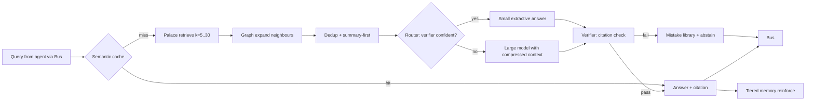

# Brain v2 — design (cycle 1, proposal only)
Modules: **Palace** (FTS5 chunks, citations) · **Graph** (fullpicture nodes/edges) · **Bus** (tools/collab bus.py, agent messages) · **Verifier** (citation check + abstain) · **Cache** (semantic, Jaccard≥0.75) · **Compressor** (dedup + summary-first) · **Router** (small extractive path vs large model) · **Mistake library** (dev misses → boosts) · **Tiered memory** (hot LRU / warm rick / cold full).

Measured each cycle (c1 numbers in RESULTS.md): held-out cloze accuracy, verifier precision, tokens per query, cache hit rate and latency, recall@1/@5, and the no-regression test (test_c1.py).
