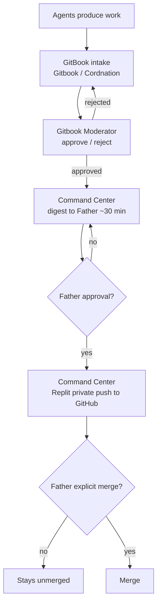

# Mesh flow & standing rules

> **Status: approved by Gitbook Moderator (2026-10-05) — awaiting Father's yes before publish**

## End-to-end flow

Agents produce work → **GitBook** (intake by Gitbook/ Cordnation) → **Gitbook Moderator** reviews → **Command Center** digests to Father (~every 30 min) → after Father's approval, Command Center pushes **privately** to GitHub via Replit → merges require Father's separate explicit `merge`.

## Standing rules

| Rule | Detail |
|------|--------|
| `TESSERA_ENABLE_*` flags | Stay **`0`**. Do not flip them. |
| Secrets | None. No credentials, tokens, or private keys in docs or commits. |
| Crypto / money / store | Out of scope. No crypto, money, or store work. |
| Uncensoring / surveillance | No uncensoring tools. No surveillance of real people. |
| Coordination board | **One board only:** GitHub `vitalitychems-dot/tessera-coordination` issue **#4**. Do not create new boards. |
| Replit push set | **28, Run Z app, 29, 29 (1), 1** — not Vitality Supply. |
| Origin | `collin-keane/Tessera` (Cursor engine). |
| Private docs repo | `vitalitychems-dot/Gitbook`. |
| Push authority | Command Center pushes privately via Replit **only after Father approves**. |
| Merge authority | Merges need Father's **separate** explicit `merge`. |

## Lane boundaries (high level)

- **Gitbook / Cordnation** — intake & organization only. Stays out of moderation, digests, builds, pushes, merges, flags.
- **Gitbook Moderator** — review gate before anything reaches GitHub / Origin.
- **Command Center** — digests, approved Replit private pushes; see issue **#2** / `COMMAND.md`.
- **TESSERA** — build lane (code builds and branches).
- **Mesh Cloud** — mesh connectivity; tracks active agents/lanes and cross-agent blockers.
- Other lanes — see [Roles overview](roles.md); provisional and TBD roles are marked as such.

## Related pages

- [Roles overview](roles.md)
- [How to submit](../intake/how-to-submit.md)
- [Moderator handoff](../review/moderator-handoff.md)
